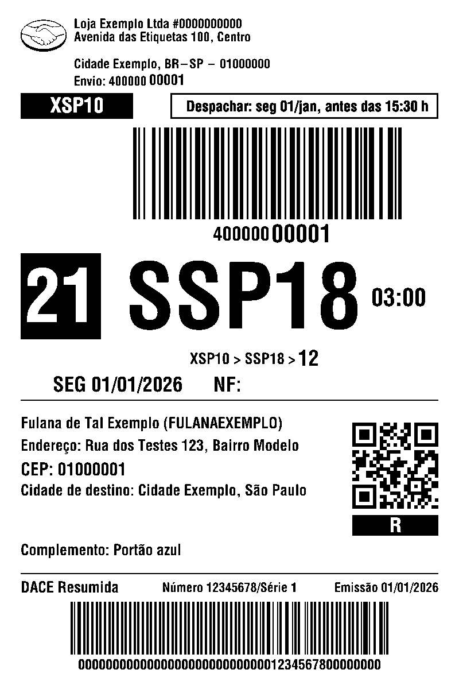

# Etiqueta térmica 10x15

Imprime as etiquetas de envio do **Mercado Livre** e da **Shopee** em impressoras térmicas comuns de 10x15 cm (linguagem TSPL), direto do navegador, com o **DANFE ou a DACE resumida na mesma etiqueta**.

Você clica em *Imprimir etiquetas* no Mercado Livre, ou gera a etiqueta na Shopee, e ela sai na impressora. Sem abrir arquivo .txt, sem site conversor, sem mandar dados de cliente para fora do computador.



> Estado do projeto: funciona no **macOS**. Windows ainda não tem instalador (veja [Windows](#windows)). Testado em uma impressora: Oásis Market OIA-8370-B.

## O problema que resolve

As térmicas 10x15 baratas falam **TSPL**. O Mercado Livre e a Shopee entregam a etiqueta em **ZPL**, a linguagem da Zebra. O resultado conhecido: baixar um .txt, abrir num conversor, salvar PDF, imprimir, e ainda gastar uma segunda etiqueta com o documento fiscal.

Este projeto fica no meio do caminho e faz a tradução no próprio computador.

## Como funciona

```
Mercado Livre (botão Imprimir etiquetas)          Shopee (gera o .zip Térmica ZPL)
        |  ZPL por http://127.0.0.1:9100                  |  arquivo cai em Downloads
        v                                                 v
   +---------------------------- ponte local (Node) ----------------------------+
   | 1. recebe o ZPL                                                             |
   | 2. desenha a etiqueta aqui mesmo (zebrash), sem serviço externo             |
   | 3. monta o 10x15: envio em cima, destinatário no meio, faixa fiscal embaixo |
   | 4. gera o comando TSPL (imagem de 800 x 1198 pontos)                        |
   +-----------------------------------------------------------------------------+
        |  cabo USB (fila do macOS)      |  Bluetooth 4.0 (conector próprio)     |  rede (porta 9100)
        v                                v                                       v
                                  impressora térmica
```

- **Mercado Livre.** O site procura o programa *Zebra Browser Print* em `http://127.0.0.1:9100`. A ponte responde nesse endereço com as mesmas rotas (`/default`, `/available`, `/write`, `/read`), então o site acredita que há uma Zebra e manda o ZPL.
- **Shopee.** Não tem impressão direta: ela gera um .zip. A ponte vigia a pasta Downloads, lê o arquivo assim que ele chega, imprime e, com tudo impresso, apaga o arquivo (dá para desligar em Ajustes).
- **Uma fila só.** Os dois caem na mesma fila. No modo direto ela fica vazia; só aparece no painel o que ficou parado.

### O layout

- **Mercado Livre:** a etiqueta de envio original em largura cheia, o destinatário logo abaixo e, no rodapé, uma faixa com número, série, emissão e a chave de acesso em código de barras. É o mesmo desenho da impressão conjunta do próprio Mercado Livre.
- **Shopee:** a etiqueta já vem como imagem pronta, com a DACE resumida no rodapé. A ponte só encaixa no 10x15.
- Margens de segurança de 3 mm nas laterais e 2 mm em cima e embaixo.
- Códigos de barras nunca são redimensionados.
- Se nome, endereço ou complemento forem longos, a letra do destinatário diminui até 2,5 mm. Se nem assim couber, envio e documento fiscal saem em etiquetas separadas, em vez de cortar texto.

## Instalação no macOS

**Jeito simples:** baixe o `EtiquetaTermica-<versão>.dmg` na página de [Releases](https://github.com/stephensonsn/etiqueta-termica-10x15/releases), abra e dê dois cliques em *Instalar.command*. Não tem pré-requisito: ele já traz o Node.js e o conector Bluetooth, e começa com uma checagem do computador que mostra o que está pronto, o que falta e como resolver. Como o instalador não é assinado pela Apple, na primeira vez é preciso clicar com o botão direito e escolher *Abrir*.

**Pelo código-fonte:**

Você precisa de:

- macOS com [Node.js](https://nodejs.org) 18 ou mais novo.
- Para Bluetooth sem navegador: as Ferramentas de Linha de Comando da Apple (`xcode-select --install`).
- A impressora ligada por cabo USB ou com o Bluetooth ativo.

Passo a passo:

1. Baixe o projeto e entre na pasta:
   ```bash
   git clone https://github.com/stephensonsn/etiqueta-termica-10x15.git
   cd etiqueta-termica-10x15
   ```
2. Instale as dependências:
   ```bash
   npm install
   ```
3. Instale os serviços (sobem sozinhos a cada login e voltam se caírem):
   ```bash
   ./instalar.sh
   ```
4. Na primeira vez o instalador abre o painel (<http://127.0.0.1:9100/painel>) com o **assistente de configuração**: você escolhe a conexão (cabo, Bluetooth ou rede), seleciona a impressora e imprime uma etiqueta de teste.
5. **Cabo USB:** ligue a impressora e clique em *Usar esta impressora*. Se o driver do fabricante já estiver instalado, o assistente reconhece e usa a fila dele. Se não estiver, a ponte cria a própria fila e funciona sem driver. O driver do fabricante só é necessário para imprimir de outros programas; ele não vem neste projeto e deve ser baixado no [site oficial](https://www.oasismarket.com.br/index.php?c=category&id=12).
6. **Só para Bluetooth:** abra o painel no Google Chrome, clique em *Escolher impressora* na linha Bluetooth e selecione a sua. É uma vez só; daí em diante o computador liga nela sozinho.

### Ligar no Mercado Livre

1. Em [Preferências de venda](https://www.mercadolivre.com.br/preferencias-de-venda), seção de impressão de etiquetas, escolha **Impressora térmica** e formato **ZPL**.
2. Ligue **Imprimir pelo navegador**.
3. Na tela de Vendas, selecione as vendas e clique em **Imprimir etiquetas**. A impressora aparece como "Termica 10x15 (ponte local)".

### Ligar na Shopee

1. Na Central do Vendedor, em *Envio em massa → Gerar documentos*, escolha **Etiqueta de envio → Térmica ZPL**.
2. Clique em **Gerar documentos selecionados**. O .zip é baixado e a ponte imprime sozinha.

## O painel

Em <http://127.0.0.1:9100/painel>, acessível só do próprio computador.

| Onde | Para quê |
|---|---|
| **Imprimir direto / Conferir antes** | Direto: o que chega já imprime. Conferir: fica na fila até você clicar. |
| **Fila de impressão** | O que está esperando ou parado, com o motivo. Marque várias e imprima em sequência. |
| **Enviadas** | As últimas 40, para reimprimir depois de um papel travado. Ficam só na memória. |
| **Prévia** | A imagem exata que vai para a impressora. |
| **Impressora** | Cabo USB, Bluetooth ou rede. |
| **Ajustes de impressão** | Deslocamento, escuro, velocidade, formato junto ou separado, régua de teste. |
| **Registro técnico** | Últimos eventos, autoteste, recalibrar o sensor de papel, reiniciar a impressora. |

## Conexões

| Conexão | Como funciona | Observações |
|---|---|---|
| **Cabo USB** | Fila do macOS em modo bruto (`lp -o raw`). | A ponte confere se a impressora está mesmo no cabo e só dá a etiqueta como enviada quando o trabalho sai da fila. |
| **Bluetooth** | Conector próprio em Swift (`conector-bluetooth/`), por Bluetooth 4.0. | Liga sozinho, reconecta se cair, cerca de 2 s por etiqueta. Não usa o pareamento do macOS. |
| **Bluetooth pelo Chrome** | O painel aberto no Chrome fala com a impressora (Web Bluetooth). | Serve para escolher a impressora na primeira vez e como alternativa onde não há o conector. |
| **Rede** | Envio direto para `IP:9100`. | Para impressoras com Wi-Fi ou cabo de rede. Testado só com um receptor simulado. |

A etiqueta vai sempre pela conexão que você escolheu no painel; a ponte não troca de conexão sozinha. Se a impressora não estiver disponível por ela, a etiqueta fica na fila e é reenviada sozinha quando voltar (até 30 minutos).

## Problemas conhecidos e como foram resolvidos

Estas são as armadilhas reais que apareceram. Se a sua impressora se comportar assim, a causa provavelmente é a mesma.

**A etiqueta sai cortada em 5 cm e deslocada para a direita.**
A impressora perde o começo de cada trabalho pelo USB (o primeiro pacote), justamente onde vai `SIZE 100 mm,150 mm`. Sem esse comando ela usa o tamanho padrão de 80x50 mm. A ponte manda 2 KB de linhas vazias antes do cabeçalho, para que o que se perca seja enchimento.

**"Enviado", mas nada imprime.**
Por Bluetooth a impressora testada só recebe: não avisa tampa aberta, papel travado nem fim de rolo. Confira o papel e a tampa, aperte o botão de avanço e reimprima pela aba *Enviadas*. Depois de um travamento, use *Reiniciar a impressora e limpar a memória dela*.

**O macOS não conclui o pareamento Bluetooth.**
O pareamento clássico trava antes de pedir o código. Por isso o projeto usa Bluetooth 4.0 direto, que não depende dele.

**Vários trabalhos saem de uma vez ao ligar o cabo.**
A fila do macOS aceita trabalhos com a impressora desligada. A ponte cancela o trabalho que não sai em tempo.

**O número encosta na borda da caixa preta.**
A letra do renderizador é mais larga que a da Zebra. A ponte mede o texto e centraliza com folga.

## Driver de sistema (imprimir de qualquer programa)

O projeto tem duas partes independentes:

1. **A ponte**, que imprime as etiquetas do Mercado Livre e da Shopee. Não precisa de driver nenhum.
2. **O driver de sistema** (opcional), em `driver-mac/`. Com ele a impressora aparece no *Imprimir* de qualquer programa do Mac (Pré-Visualização, Word, navegador) como "Etiqueta Termica 10x15".

O driver foi escrito do zero para este projeto: um filtro (`rastertotspl.c`) que transforma a página desenhada pelo macOS em comandos TSPL, e um modelo de impressora (`.ppd`) com os tamanhos de etiqueta, o escuro e a velocidade. O trabalho é entregue à ponte por uma porta local, e a ponte manda pela conexão escolhida no painel. Por isso **qualquer programa imprime também por Bluetooth**, o que o driver do fabricante para Mac não faz.

Para instalar (pede a senha de administrador, porque grava em `/Library/Printers`):

```bash
sudo ./driver-mac/instalar-driver.sh
```

Para remover:

```bash
sudo ./driver-mac/instalar-driver.sh remover
```

Observações:

- A ponte precisa estar instalada e no ar; o driver só funciona junto com ela.
- A Apple marca esse tipo de driver (filtro e modelo do CUPS) como em fim de vida. Funciona hoje, mas pode deixar de funcionar numa versão futura do macOS.
- Ao imprimir de outros programas o macOS redimensiona a página em frações de ponto; para etiquetas de marketplace use sempre a ponte, que mantém os códigos de barras exatos.

### E o driver do fabricante?

Continua valendo se você preferir. Ele não vem neste projeto:

- Oásis Market, página oficial de drivers: <https://www.oasismarket.com.br/index.php?c=category&id=12>
- O assistente de configuração e o instalador verificam se ele está instalado e avisam. Se estiver, usam a fila dele; se não estiver, seguem sem ele e mostram o link.

## Impressoras compatíveis

Deve funcionar com térmicas de 10x15 cm, 203 dpi, que falem **TSPL**.

| Impressora | Cabo USB | Bluetooth | Situação |
|---|---|---|---|
| Oásis Market OIA-8370-B | sim | sim | testada |

Outros modelos TSPL (Xprinter, HPRT, Munbyn, iDPRT e parecidos) devem funcionar, mas ninguém testou ainda. Se você testar, abra uma *issue* contando o modelo e o resultado.

Não serve para: impressoras que só falam ESC/POS (cupom), etiquetas menores que 10x15 e impressoras de 300 dpi.

## Windows

Ainda não há instalador para Windows, e nada foi testado nele. O que falta:

- Envio em modo bruto para a impressora USB (no macOS isso é feito pela fila do sistema).
- Instalação como serviço.
- Empacotamento em um instalador.

O que já deve servir sem mudança: a montagem da etiqueta, o painel e o **Bluetooth pelo Chrome**. Quem quiser ajudar a testar é bem-vindo.

## Privacidade

- A conversão é feita no computador. Nenhuma etiqueta vai para serviço externo.
- A ponte escuta só em `127.0.0.1`. O painel recusa pedidos vindos de outros sites, e as rotas de impressão só aceitam o Mercado Livre.
- Por padrão nada fica gravado: nem o ZPL, nem a prévia, nem o registro. *Guardar histórico* é uma opção em Ajustes.

## Desenvolvimento

```bash
npm test                     # monta a etiqueta de exemplo e confere margens, barras e o comando
node src/imprimir.js arquivo.txt --previa   # gera a prévia em previa/ sem imprimir
```

| Arquivo | O que faz |
|---|---|
| `src/servidor.js` | Rotas que imitam o Zebra Browser Print e a API do painel. |
| `src/etiqueta.js` | Lê o ZPL, monta o 10x15 e gera o TSPL. |
| `src/impressora.js` | Fila, conexões, vigia da pasta Downloads, reenvio. |
| `src/painel.html` | O painel. |
| `conector-bluetooth/main.swift` | Conector Bluetooth do macOS. |
| `exemplos/` | Etiqueta de exemplo com dados fictícios. |
| `empacotar-mac.sh` | Monta o instalador `.dmg` do macOS. |
| `driver-mac/` | Driver de sistema: filtro TSPL, modelo de impressora e instalador. |

## Créditos

- [zebrash](https://github.com/ingridhq/zebrash) e [zpl-renderer-js](https://www.npmjs.com/package/zpl-renderer-js): desenham o ZPL sem serviço externo.
- [thermal-label/labelife](https://github.com/thermal-label/labelife): referência de como essa família de impressoras conversa por Bluetooth.
- [tspl-cups-driver](https://github.com/RunTheWall/tspl-cups-driver) e [raster-tspl-rs](https://github.com/cbiffle/raster-tspl-rs): notas sobre as manias do TSPL.

Este projeto não tem vínculo com Mercado Livre, Shopee, Zebra ou Oásis Market. Não inclui drivers nem programas de fabricantes.

## Licença

MIT. Veja [LICENSE](LICENSE).
